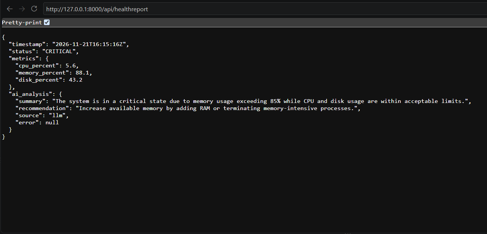
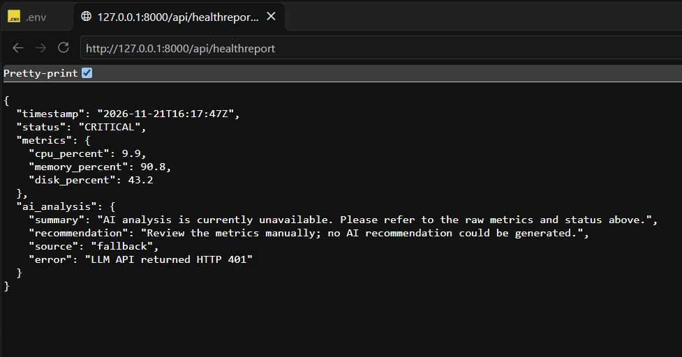
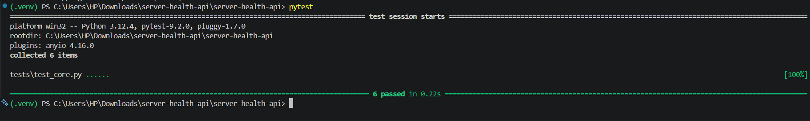

# Smart Server Health Diagnostics API

A small FastAPI service that reads live CPU, memory and disk usage from the local machine,
classifies the overall status, and asks an LLM (Groq / Gemini / OpenAI) for a short
human-readable summary and one recommendation. If the LLM fails, the API still returns
the raw metrics plus a clean fallback message.

## Features

* Live CPU, memory and disk usage via `psutil`
* Status classification: over 85% is `CRITICAL`, over 70% is `WARNING`, otherwise `HEALTHY`
* AI summary and one practical recommendation (Groq, Gemini or OpenAI)
* Clean fallback if the API key is missing or the AI request fails
* FastAPI with Swagger UI at `/docs`
  
## Project structure

```
app/
  config.py        # env vars + thresholds (no hardcoded keys)
  metrics.py       # psutil collection + status classification
  ai_analysis.py   # prompt, LLM call, output parsing, fallback handling
  main.py          # FastAPI route only
tests/test_core.py # unit tests (LLM is mocked, no API key needed)
docs/screenshots/  # screenshots used in this README
```

## Setup (Python 3.9+)

Run all commands from the project root (the folder that contains `app/` and `requirements.txt`).

```bash
python -m venv .venv             # Windows: py -m venv .venv
source .venv/bin/activate        # Windows: .venv\Scripts\activate
pip install -r requirements.txt

cp .env.example .env             # Windows: copy .env.example .env
# edit .env and set LLM_API_KEY (and LLM_PROVIDER if not using Groq)
```

Free API keys: Groq -> https://console.groq.com, Gemini -> https://aistudio.google.com

> **Troubleshooting:** if the LLM call returns HTTP 404, the default model may have been retired by the provider.
> Set `LLM_MODEL` in `.env` to a currently available model (e.g. `LLM_MODEL=openai/gpt-oss-20b` for Groq) and restart the server.

## Run

```bash
uvicorn app.main:app --reload
```

## Test the endpoint

```bash
curl http://127.0.0.1:8000/api/healthreport
```

On Windows PowerShell, `curl` is an alias for a different command, so use `curl.exe http://127.0.0.1:8000/api/healthreport`, or just open the URL in your browser.

You can also open http://127.0.0.1:8000/docs for the interactive Swagger UI.

Run unit tests: `pytest`

## Sample output

Real output from a live run (Groq, status CRITICAL because memory was above 85%):

```json
{
  "timestamp": "2026-11-21T12:39:09Z",
  "status": "CRITICAL",
  "metrics": {
    "cpu_percent": 9.6,
    "memory_percent": 90.6,
    "disk_percent": 42.8
  },
  "ai_analysis": {
    "summary": "The system is in a critical state due to memory usage exceeding 85%. CPU and disk usage are within acceptable limits.",
    "recommendation": "Reduce memory consumption by terminating or optimizing high-memory processes, or add additional RAM.",
    "source": "llm",
    "error": null
  }
}
```

## Screenshots

**Live response (LLM working)**



**Fallback when the LLM fails (invalid API key, HTTP 401)**



**Unit tests passing**



## Failure handling (manually tested)

In every case the endpoint still returns HTTP 200 with real metrics and `"source": "fallback"`.

| Scenario | How it was triggered | Result in `ai_analysis.error` |
|---|---|---|
| Missing API key | `LLM_API_KEY=` (empty) | `LLM_API_KEY is not configured` |
| Invalid API key | `LLM_API_KEY=abc` | `LLM API returned HTTP 401` |
| Timeout | `LLM_TIMEOUT_SECONDS=0.001` | `LLM request timed out` |
| Retired/unknown model | default model had been retired | `LLM API returned HTTP 404` (fixed via `LLM_MODEL`) |
| Malformed LLM output | covered by unit test | `LLM returned an unexpected response format` |

## Design notes

- **Status rule:** each metric is compared to the thresholds (>70 WARNING, >85 CRITICAL,
  configurable in `.env`); overall status is the worst of the three.
- **Prompt:** includes metrics, status and thresholds, and demands a JSON object with exactly
  `summary` and `recommendation`. JSON mode is requested from the provider, and the parser
  also tolerates code fences/extra text.
- **Resilience:** missing key, timeout (default 10s), HTTP errors, network errors and malformed
  output are all caught in `get_ai_analysis`, which never raises.
- **Sync route:** the endpoint is a plain `def` so FastAPI runs the blocking psutil/HTTP calls
  in a threadpool instead of blocking the event loop.
- **Extra fields:** `source` and `error` were added to `ai_analysis` so clients can tell LLM
  output from fallback output.
